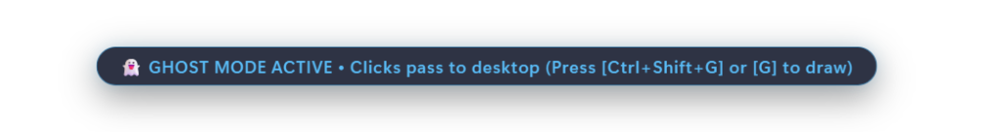
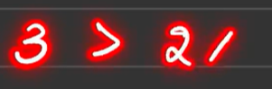
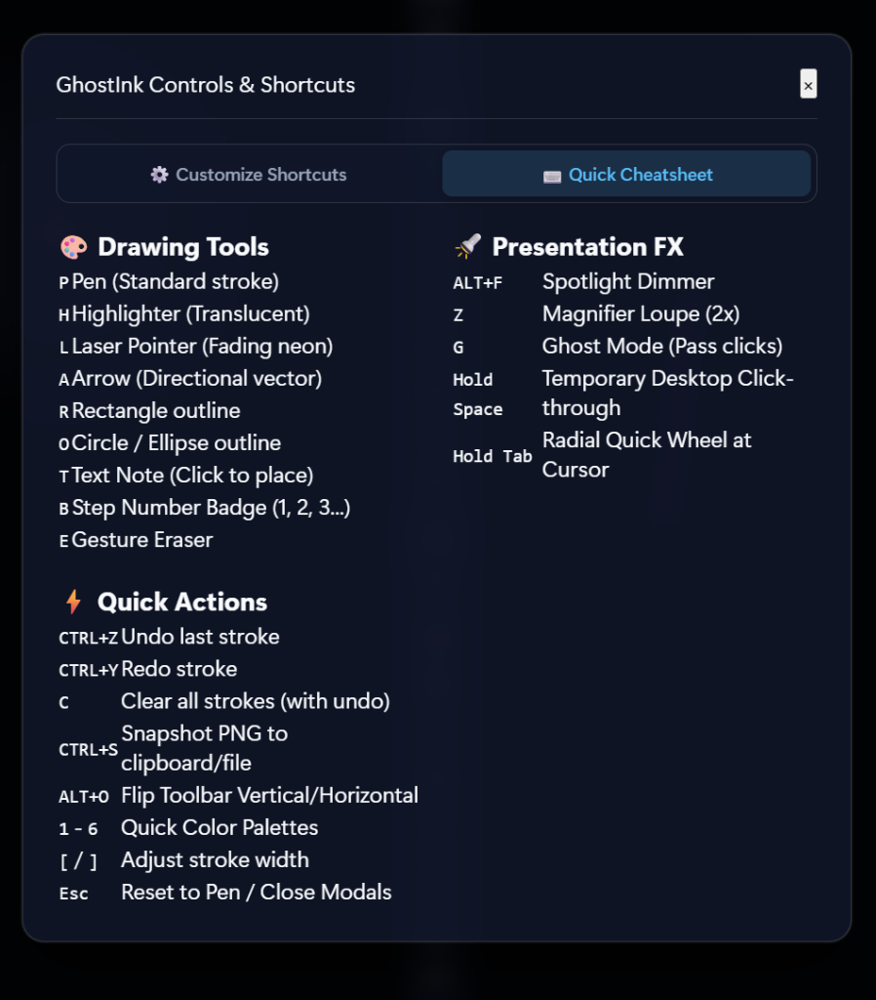

# Inkova 💎🖊️

> **The next-generation, ultra-fast screen annotation and live presentation toolkit for desktop.**  
> Built with **Tauri v2 (Rust)**, **TypeScript**, and **HTML5 Canvas2D**.

[](https://github.com/kanahaiya/inkova/releases)
[](https://github.com/kanahaiya/inkova)
[](https://github.com/kanahaiya/inkova)
[](https://tauri.app)
[](https://www.rust-lang.org)
[](LICENSE)

<p align="center">
  
</p>

---

## ⚡ Quick Download & Install (Windows)

Inkova is open-source, local-first, and contains zero adware or cloud spyware.

| Package | Format | Best For | Link |
| :--- | :---: | :--- | :--- |
| **Inkova Setup** | `.exe` (NSIS) | Automatic desktop shortcuts, dual per-user / per-machine install | [Download Installer](https://github.com/kanahaiya/inkova/releases/latest) |
| **Inkova Portable** | `.exe` | Zero-installation, runs instantly off USB or corporate restricted PCs | [Download Portable](https://github.com/kanahaiya/inkova/releases/latest) |
| **Windows Package Manager** | `winget` | Developers & terminal power users | `winget install Inkova` |

> 🛡️ **Note for First-Time Windows Users:**  
> As a brand-new indie application, Windows Defender SmartScreen may display an *"Unknown Publisher"* prompt. Simply click **"More info" ➔ "Run anyway"**. Inkova is 100% open-source and virus-free.

---

## 💎 Free vs. Pro Edition

Inkova follows an **Open-Core** model. The core drawing toolkit is free and open-source forever. Professional presentation tools can be unlocked with a single **$29 Lifetime License** (up to 3 personal devices).

| Feature / Tool | Free Tier | Pro Edition ($29 Lifetime) |
| :--- | :---: | :---: |
| **Smooth Bézier Pen (`P`)** | ✅ Free Forever | ✅ |
| **Alpha Highlighter (`H`)** | ✅ Free Forever | ✅ |
| **Arrows, Lines, Rectangles, Circles (`A, I, R, O`)** | ✅ Free Forever | ✅ |
| **In-Place Text Notes (`T`)** | ✅ Free Forever | ✅ |
| **Smart Vector Eraser & Undo/Redo (`E, Ctrl+Z, Ctrl+Y`)** | ✅ Free Forever | ✅ |
| **High-Res Snapshot Export & Clipboard Copy (`Ctrl+S`)** | ✅ Free Forever | ✅ |
| **Radial Quick Menu (`Tab`) & Glass Mode (`Space`)** | ✅ Free Forever | ✅ |
| **⚡ Neon Fading Laser Pointer (`L`)** | 🔒 Pro | ✅ Included |
| **🔦 Spotlight Stage Dimmer Beam (`F`)** | 🔒 Pro | ✅ Included |
| **🔍 Floating 2x Loupe Zoom Lens (`Z`)** | 🔒 Pro | ✅ Included |
| **🕶️ Live Frosted-Glass Redaction Blur (`X`)** | 🔒 Pro | ✅ Included |
| **🔢 Auto-Incrementing Step Badges (`B`)** | 🔒 Pro | ✅ Included |
| **🖥️ Multi-Display Live Switching** | 🔒 Pro | ✅ Included |
| **Device Activations per License** | Unlimited | 3 Personal Machines |
| **Commercial Presenter Rights** | Personal | Full Commercial |

---

## 💡 What is Inkova?

**Inkova** is an all-in-one desktop screen annotation, whiteboard, and presentation toolkit designed from first principles for software engineers, keynote speakers, educators, and live streamers. It bridges the gap between lightweight desktop pens (*Epic Pen, ppInk*) and professional presentation suites (*Microsoft ZoomIt, Presentify, CleanShot X*).

At the core of Inkova is the **"Glass Layer"**: a zero-latency, full-screen transparent canvas overlay with OS-level click-through passthrough. You can seamlessly switch between drawing annotations over active code or slides and interacting directly with underlying applications, browser tabs, and desktop windows—with zero visual clutter.

---

## ✨ Features & Capabilities

### 💎 1. Instant Glass Mode & Hold-to-Interact
* **Hold `Spacebar`:** Temporarily switches into Glass Mode. Clicks, scrolls, and drags pass straight through to desktop applications behind the canvas (`WS_EX_TRANSPARENT`). Releasing `Spacebar` instantly re-arms drawing.
* **Toggle `G` or `Ctrl+Shift+G`:** Toggle persistent Glass Mode on or off from anywhere in the OS via native global shortcuts.
* **System Tray Recovery:** Right-click the system tray icon and select **Show / Focus** to safely clear cursor passthrough and restore drawing focus.

<p align="center">
  
</p>

### 🎯 2. Zero-Footprint Radial Menu (`Tab`)
* Hold **`Tab`** anywhere on screen to bloom a rapid 8-slice pie menu directly beneath your cursor.
* Flick your pointer toward any primary tool (Pen, Highlighter, Laser, Arrow, Shapes, Blur, Spotlight) and release.
* Eliminates the need to constantly move your mouse back to a floating toolbar.

### 🪄 3. Procreate-Style "Hold-to-Snap" Vector Recognition
* Draw rough freehand lines, directional arrows, rectangles, or circles/ellipses.
* Hold your pointer steady for **550ms** (`maxMovement <= 8px`). Inkova's geometric pattern engine automatically recognizes the intent and snaps the stroke into crisp vector geometry.
* Dynamic jitter tolerance preserves recognized vectors until deliberate repositioning.

### 🖊️ 4. Comprehensive Annotation & Drawing Suite
* **🖊️ Pen (`P`):** High-DPI freehand drawing powered by real-time midpoint quadratic Bézier curve interpolation (silky smooth even on 144Hz+ displays).
* **🖍️ Highlighter (`H`):** Translucent marker with off-screen compositing buffer, ensuring overlapping multi-pass strokes do not form dark compound alpha seams.
* **⚡ Fading Neon Laser Pointer (`L`):** Temporary glowing pointer trail that automatically evaporates after 1.5–3 seconds.
* **↗️ Directional Arrow (`A`):** Point-to-point arrows with automatically calculated arrowheads.
* **📏 Straight Ruler Line (`I`):** Direct constrained straight-line drawer.
* **🔲 Vector Rectangle (`R`):** Crisp box framing for UI components and code snippets.
* **⭕ Vector Ellipse / Circle (`O`):** Perfect circular highlighting.
* **🔤 In-Place Text Notes (`T`):** Click anywhere on screen to drop crisp typed notes with automatic blur-commit handling.
* **🧹 Smart Segment Eraser (`E`):** Orthogonal point-to-segment projection hit-testing reliably deletes fast strokes with batched single-step undo history.

<p align="center">
  
</p>

### 🔍 5. Interactive Presentation & Redaction Suite
* **🔦 Spotlight Focus Beam (`F`):** Dims the surrounding desktop clutter by 76% with an adjustable spotlight ring centered on your cursor.
* **🔎 Floating 2x Loupe Zoom (`Z`):** Live magnifier lens to inspect fine pixel details, font kerning, and small UI elements.
* **🔢 Auto-Incrementing Step Badges (`B`):** Stamp numbered circular callouts (①, ②, ③) for tutorials, documentation, and bug reports. **Right-click** decrements or resets the step counter.
* **🕶️ Live Frosted-Glass Redaction (`X`):** Instantly conceal passwords, API secrets, and PII behind an on-screen frosted blur filter.
* **📋 Virtual Backdrops:** Switch effortlessly between **Transparent Desktop**, **Solid Whiteboard**, **Solid Blackboard**, and **Dot Grid**.

### 🛡️ 6. Erase Protection & Instant Clipboard Snapshot
* **📸 Snapshot Export & Clipboard Copy (`Ctrl+S`):** Saves high-resolution canvas PNGs directly via native OS file dialogs and simultaneously copies PNG image bytes straight to your system clipboard for instant pasting into Slack, GitHub, or Discord.
* **🗑️ Clear Screen (`C`):** Instant canvas flush backed by a 6-second floating **"Undo Clear (Ctrl+Z)"** recovery safety toast. Never lose notes from an accidental click.
* **❓ Interactive Cheatsheet (`?` / `Shift+/`):** Built-in modal listing all tools, shortcuts, and gestures. Press **`Esc`** at any time to dismiss modals, cancel active previews, or return to drawing.

<p align="center">
  
</p>

---

## ⌨️ Complete Keyboard & Shortcut Reference

### In-App Shortcuts

| Hotkey | Action | Description |
| :---: | :--- | :--- |
| <kbd>P</kbd> | **Pen** | Freehand drawing with Bézier curve smoothing |
| <kbd>H</kbd> | **Highlighter** | Translucent marker with seamless alpha blending |
| <kbd>L</kbd> | **Laser Pointer** | Fading neon laser trail with auto-decay |
| <kbd>A</kbd> | **Arrow** | Directional arrow with head geometry |
| <kbd>I</kbd> | **Line** | Constrained straight ruler line |
| <kbd>R</kbd> | **Rectangle** | Geometric box outline |
| <kbd>O</kbd> | **Circle / Ellipse** | Vector ellipse / circular callout |
| <kbd>B</kbd> | **Step Badge** | Auto-incrementing numbered badge (①, ②, ③) |
| <kbd>T</kbd> | **Text Note** | In-place on-screen typography note |
| <kbd>X</kbd> | **Blur / Redact** | Frosted-glass redaction box |
| <kbd>E</kbd> | **Eraser** | Point-to-segment vector stroke eraser |
| <kbd>F</kbd> | **Spotlight** | 76% desktop dimmer spotlight beam |
| <kbd>Z</kbd> | **Loupe Zoom** | Interactive 2x floating magnifier |
| <kbd>G</kbd> | **Toggle Glass** | Toggle desktop click-through mode |
| <kbd>Space</kbd> *(Hold)* | **Hold Glass** | Temporary pass-through; release to resume drawing |
| <kbd>Tab</kbd> *(Hold)* | **Radial Menu** | Open 8-tool pie menu directly under mouse pointer |
| <kbd>Esc</kbd> | **Cancel / Reset** | Dismiss modals, exit spotlight/zoom, cancel preview |
| <kbd>?</kbd> | **Cheatsheet** | Show keyboard shortcut cheat sheet modal |
| <kbd>Ctrl</kbd> + <kbd>Z</kbd> | **Undo** | Step backward through stroke history |
| <kbd>Ctrl</kbd> + <kbd>Y</kbd> / <kbd>Ctrl</kbd>+<kbd>Shift</kbd>+<kbd>Z</kbd> | **Redo** | Step forward through stroke history |
| <kbd>Ctrl</kbd> + <kbd>S</kbd> | **Snapshot** | Save PNG to disk and copy directly to OS clipboard |
| <kbd>C</kbd> | **Clear Canvas** | Clear screen with 6-second undo toast recovery |
| <kbd>Alt</kbd> + <kbd>O</kbd> | **Flip Orientation** | Toggle between Horizontal Bar and Vertical Dock |
| <kbd>Ctrl</kbd> + <kbd>Shift</kbd> + <kbd>H</kbd> | **Hide to Tray** | Hide window completely into system tray notification area |
| <kbd>1</kbd> – <kbd>8</kbd> | **Color Swatches** | Switch active color (Red, Amber, Green, Cyan, Purple, Pink, White, Black) |
| <kbd>[</kbd> / <kbd>]</kbd> | **Stroke Width** | Decrease / Increase brush thickness |
| **Right-Click** | **Badge Decrement** | Decrement step counter or reset when using Badge tool |

### System-Wide Global Shortcuts (OS-Level)

These shortcuts work globally across Windows even when Glass Mode has passed OS cursor focus to underlying applications or when Inkova is minimized to the system tray:

| Global Shortcut | Action | Scope |
| :---: | :--- | :--- |
| <kbd>Ctrl</kbd> + <kbd>Shift</kbd> + <kbd>H</kbd> | **Toggle Inkova Visibility** | Instant summon / hide to system tray from anywhere |
| <kbd>Ctrl</kbd> + <kbd>Shift</kbd> + <kbd>D</kbd> | **Switch Active Display** | Jump overlay and toolbar to next connected monitor |
| <kbd>Ctrl</kbd> + <kbd>Shift</kbd> + <kbd>G</kbd> | **Toggle Glass Mode** | OS-level safe recovery from pass-through |
| <kbd>Ctrl</kbd> + <kbd>Shift</kbd> + <kbd>C</kbd> | **Global Clear Canvas** | Clears on-screen ink from any application |
| <kbd>Ctrl</kbd> + <kbd>Shift</kbd> + <kbd>A</kbd> | **Global Escape & Focus** | Cancels overlay modes and refocuses Inkova |

---

## 🏗️ Architecture & Technical Stack

Inkova employs a decoupled dual-canvas rendering pipeline on top of a secure Tauri v2 Rust host:

```
┌────────────────────────────────────────────────────────────────────────┐
│                        Tauri v2 Native Host (Rust)                     │
│  - Windowing: Fullscreen, transparent, always-on-top, click-through   │
│  - System Tray: Menu with Show/Focus recovery and clean app exit       │
│  - Global Shortcuts: @tauri-apps/plugin-global-shortcut                │
│  - Native I/O: @tauri-apps/plugin-dialog, plugin-fs, clipboard-manager │
└───────────────────────────────────┬────────────────────────────────────┘
                                    │ IPC / Window Events
┌───────────────────────────────────▼────────────────────────────────────┐
│                  Frontend Inking Engine (TypeScript + Canvas2D)        │
│                                                                        │
│   ┌────────────────────────────────┐  ┌────────────────────────────┐   │
│   │     Main Canvas (Persistent)   │  │   FX Canvas (Interactive)  │   │
│   │  - Committed vector strokes    │  │  - Active drawing preview  │   │
│   │  - Step badges & text notes    │  │  - Fading laser decay      │   │
│   │  - Backdrop fills (Glass/Grid) │  │  - Spotlight & 2x Loupe    │   │
│   └────────────────────────────────┘  └────────────────────────────┘   │
│                                                                        │
│   ┌───────────────────────┐  ┌───────────────────────┐  ┌───────────┐   │
│   │   History Manager     │  │   Stroke Recognizer   │  │ UI Layer  │   │
│   │  - Batched Undo/Redo  │  │  - Line/Rect/Circle   │  │ - Toolbar │   │
│   │  - Clear Toast Stack  │  │  - 550ms Stillness    │  │ - Radial  │   │
│   │  - Step Sync          │  │  - Procreate Hold     │  │ - Modal   │   │
│   └───────────────────────┘  └───────────────────────┘  └───────────┘   │
└────────────────────────────────────────────────────────────────────────┘
```

### Directory Structure

```
inkova/
├── src/
│   ├── engine/
│   │   ├── canvas.ts            # Dual-canvas pipeline, Bézier smoothing, laser decay, loupe & spotlight
│   │   ├── canvas.test.ts       # 7 Vitest unit tests for canvas rendering and hit-testing
│   │   ├── history.ts           # Immutable vector history stack & clear-recovery mechanism
│   │   ├── history.test.ts      # 6 Vitest unit tests for undo/redo and clear recovery
│   │   ├── recognizer.ts        # Geometric pattern engine (lines, rectangles, ellipses)
│   │   └── recognizer.test.ts   # 6 Vitest unit tests for hold-to-snap recognition
│   ├── ui/
│   │   ├── toolbar.ts           # Glassmorphic draggable floating toolbar
│   │   ├── radialMenu.ts        # Zero-footprint 8-slice cursor pie menu
│   │   ├── radialMenu.test.ts   # 4 Vitest unit tests for radial geometry & angle mapping
│   │   └── hotkeys.ts           # Local and OS-level global shortcut bindings
│   ├── types.ts                 # TypeScript data contracts (Stroke, Point, ToolType, AppState)
│   ├── styles.css               # Modern dark glassmorphic styling, animations, and modals
│   └── main.ts                  # Application orchestration, pointer events, and IPC
├── src-tauri/
│   ├── src/
│   │   ├── lib.rs               # Tauri v2 backend, plugin initialization, system tray
│   │   └── main.rs              # Windows subsystem entry point
│   ├── capabilities/
│   │   └── default.json         # Security capability scopes (dialog, fs, clipboard, shortcuts)
│   ├── Cargo.toml               # Rust crates and Tauri v2 dependencies
│   └── tauri.conf.json          # Window transparency, CSP, and bundle specifications
├── scripts/
│   └── setup-windows-build-tools.ps1  # Automated C++ build tools setup helper for Windows
├── .github/workflows/
│   ├── ci.yml                   # Automated Vitest test suite and TypeScript validation
│   └── release.yml              # Automated multi-target installer packaging on git tags
├── BUG_TRACKER.md               # Production defect registry and verification audit
├── ui-mockup-showcase.html      # Interactive UI design lab with 10 mockup explorations
├── index.html                   # HTML5 application root
├── package.json                 # Node dependencies and npm scripts
├── tsconfig.json                # TypeScript strict compiler configuration
└── vite.config.ts               # Vite configuration and test setup
```

---

## 🚦 Developer Quick Start

### Prerequisites
* **Node.js**: v18.0.0 or later (`node -v`)
* **npm**: v9.0.0 or later
* **Rust**: 1.80+ (`rustc --version`)
* *(Windows Only)*: [Visual Studio 2022 C++ Build Tools](https://visualstudio.microsoft.com/visual-cpp-build-tools/) with the "Desktop development with C++" workload.  
  *Automated setup command:* `npm run setup:tools`

### 1. Install Dependencies
```bash
npm install
```

### 2. Run Automated Test Suite
```bash
# Run full automated test suite (57 tests across 9 test suites)
npm test

# Run tests in watch mode
npm run test:watch
```

### 3. Run Web Browser Preview
Run and test the complete drawing canvas, radial menu, and toolbar UI directly in your browser:
```bash
npm run dev
```
Open **`http://localhost:1420`** in your browser.

### 4. Run Desktop App (Tauri v2 Native Mode)
Launches the full-screen transparent desktop overlay with native window transparency and global hotkeys:
```bash
npm run tauri dev
```

### 5. Build Standalone Installer Executable
```bash
npm run tauri build
```
The optimized Windows installer (`.msi` / `.exe`) will be generated in `src-tauri/target/release/bundle/`.

---

## 🗺️ Product Roadmap

- [x] Dual-canvas 144Hz Bézier curve smoothing engine
- [x] Click-through Glass Mode with OS-level global shortcut recovery
- [x] Procreate-style 550ms hold-to-snap vector recognition (lines, rectangles, circles, arrows)
- [x] Zero-footprint cursor radial pie menu (`Tab`)
- [x] Auto-incrementing step badges (①, ②, ③) with right-click decrement
- [x] Live frosted-glass redaction box (`X`)
- [x] Spotlight screen dimmer (`F`) and 2x floating zoom loupe (`Z`)
- [x] Native clipboard PNG copy on snapshot (`Ctrl+S`)
- [x] Accidental erase recovery with 6-second undo toast
- [x] System tray integration with quick Show/Focus and Quit
- [x] 23-test automated QA test suite in CI/CD
- [ ] Phase 2: Framebuffer desktop screen capture via Win32 Desktop Duplication / `xcap`
- [ ] Phase 2: Multi-monitor virtual desktop spanning
- [ ] Phase 2: Native `WM_NCHITTEST` seamless titlebar-less window dragging
- [ ] Customizable color palette themes & tactile sound effects

---

## 📄 License

Distributed under the **MIT License**. See [`LICENSE`](LICENSE) for details.

---

<p align="center">
  Crafted with care by <a href="https://github.com/kanahaiya">Kanahaiya</a>.
</p>
